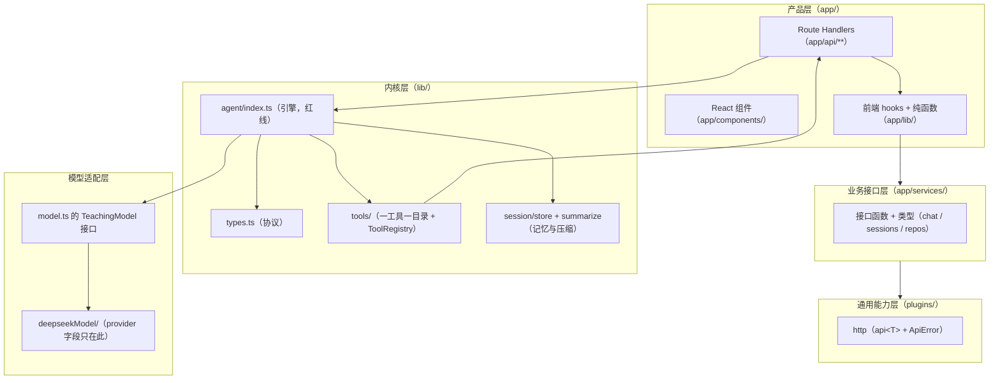

# ARCHITECTURE.md —— 项目架构设计

> **定位**：地基文档，与 `PLAN.md`（需求池与迭代）、`AGENTS.md`（规则）并列。核心回答一个问题：**加新东西时，长在哪、怎么长、动哪些文件——且不破坏现有代码。**
> **参考系**：成熟开源项目（pi / DSH / codex / smolagents / CodeWhale / Reasonix，唯一列表见 `doc/开源项目导航手册/index.md`）+ 理论框架（《Agent Harness Engineering: A Survey》的 ETCLOVG 七层）。
> **一句话架构**：**内核稳定、能力外挂**——引擎只做循环，一切能力从接缝长出去。
> ⚠️ **2026-09-18 重写**：修掉 C17 登记的过期事实（`lib/agent.ts` 平铺 / 9 个工具 / "V 验证层空白"），收编 `会话检查点.md`（已退役）的「关键决策」与「模块地图」，并移出与其它文件重复的两节（见文末）。

---

## 0. 参考坐标系（我们站在谁的肩上）

| 参考 | 架构一句话 | 我们学什么 |
|---|---|---|
| **pi** | monorepo 分包：`agent`（内核）/ `coding-agent`（产品）/ `ai`（模型适配）/ `protocol`/`telemetry`；功能长在 core/ 具体文件里；`.pi/` 用户配置目录 | 内核与产品严格分离；配置即文件 |
| **DSH** | 50+ 包，**一能力一包**：`core/agent-loop`、`hooks`、`skill`、`subagent`、`todo`、`schedule`、`sandbox`、`settings`、`llm`、`mcp`…；web 前端 + 自研 `ui-primitives` 原语库 | 能力独立成模块的粒度；UI 原语与业务组件分层 |
| **codex** | 单工具 + 胖服务端（`web.run` 10 命令、服务端有状态浏览会话）；`ext/` 扩展 | 「模型面越小、提示词越重」这条反比规律 |
| **smolagents** | 一文件一能力：`agents.py`（循环）/ `tools.py`（工具）/ `mcp_client` / `local_python_executor` / `memory` / `monitoring` | 轻量到极致的模块切分 |
| **CodeWhale** | Rust crates：`agent`/`core`/`tools`/`execpolicy`（审批）/`hooks`/`mcp`/`state`/`tui` | 审批（execpolicy）和 hooks 独立成模块 |
| **Reasonix** | Go `internal/` 90+ 包：`agent`/`permission`/`sandbox`/`memory`/`skill`/`hook`/`shellrun`/`trajectory`/`task`… | 概念的模块化粒度（命令静态分析审批） |
| **综述 ETCLOVG** | 七层：E 执行环境 / T 工具接口 / C 上下文记忆 / L 生命周期编排 / O 可观测性 / V 验证评估 / G 治理安全 | 架构设计的学术坐标；O 和 G 是开源最稀疏区（我们的主战场） |

**共识**：不是巧合——所有成熟 harness 都在用同一套分层思想，只是切分粒度不同。

---

## 1. 架构共性（从参考项目提炼的六条模式）

| # | 模式 | pi | DSH | smolagents | CodeWhale | Reasonix | **我们现状（2026-09-18）** |
|---|---|---|---|---|---|---|---|
| 1 | **内核与产品分离** | agent vs coding-agent | core vs client | agents.py | agent vs tui | agent vs desktop | ✅ `lib/` vs `app/` |
| 2 | **能力独立成模块** | core/ 文件 | 一能力一包 | 一文件一能力 | 一 crate 一能力 | 一概念一包 | ✅ `lib/` 已全面目录化（agent / config / session / tools / permission / skill / trace / commands / summarize…） |
| 3 | **统一扩展点**（工具 / 模型 / hooks） | tools + pi-ai | tools + llm + hooks | tools | tools + execpolicy + hooks | tool + permission + hook | ⚠️ 工具 ✅ + 模型 ✅ + 工具规矩投稿（C34）✅；**hooks 注册表仍是雏形**（B5） |
| 4 | **配置即文件** | `.pi/` | settings 包 | 环境变量 | config crate | config 包 | ⚠️ `lib/config/` 已是**唯一入口**；**设置页 UI 未做**（C7） |
| 5 | **可观测性独立成层** | telemetry 包 | telemetry | monitoring | telemetry | trajectory | ⚠️ 事件 + 落盘 + L3 轨迹视图 ✅；**无遥测/成本层**（C5） |
| 6 | **UI 原语与业务组件分层** | tui | ui-primitives | gradio_ui | tui + web | desktop frontend | ⚠️ `app/components/ui/` 只有 **Menu 一个原语**（B3 进行中）；业务组件 14 个 |

**结论**：六条模式里核心的 1 / 2 条已达标，3–6 条**结构对了、内容未长满** —— 方向对，差的是把隐式接缝写出来、把缺的层补上。

---

## 2. 我们的架构（三层 + 扩展层，单向依赖）



> 内核里还有几个**不被引擎直接调用**的模块，按"谁需要谁引用"挂在产品层：`lib/skill/`（技能加载）、`lib/commands/`（斜杠命令）、`lib/permission/`（审批三件套）、`lib/trace/` + `lib/trace-files/`（轨迹）、`lib/config/`（配置唯一入口）。**引擎不认识它们** —— 这就是"内核稳定、能力外挂"。

**依赖规则（可拓展的第一条纪律）**：
1. **单向**：`app → services → plugins`；`app → lib`；**`lib/` 内核不依赖任何上层**
2. **provider 字段只在适配层**（`AGENTS.md` 规则 6）
3. **引擎只透传**：新能力（signal、onChunk、onToolOutput…）以参数/回调进引擎，引擎不理解、只搬运
4. **装配点唯一在 `app/api/chat/_pipeline/`**：系统提示词、工具注册表、模型选择、压缩接线都在那里组装；引擎与工具不知道产品层的存在

---

## 3. 可拓展性的七个接缝（核心章节）

> 接缝 = 设计好的"生长点"。**接缝由需求逼出来，不预挖空壳**——但一旦出现，就要写清楚"怎么长"，让它变成规范。

### 接缝 ① 模型接缝（换大脑）
- **是什么**：`lib/model.ts` 的 `TeachingModel` 接口
- **怎么加**：新写一个实现（如 `lib/openaiModel/index.ts`），在 `app/api/chat/_pipeline/model.ts` 的 `selectModelSafe()` 注册；引擎无感
- **实例**：DeepSeek ✅（`lib/deepseekModel/`）→ 多 provider 未做（**C25**）
- **不变量**：`runAgentLoop` 永远只看到 `AssistantMessage`

### 接缝 ② 工具接缝（加手脚）
- **是什么**：`lib/tools/<工具名>/index.ts` **一工具一目录** + `ToolRegistry`（`lib/tools/index.ts`）
- **怎么加**：新目录导出 `createXxxTool(ctx)`，在 `lib/tools/index.ts` 组装注册；`lib/tools/path-utils/` 自动圈住
- **规矩怎么放**（**C34 定**）：模型看得见的"是什么 / 何时用"进 `description`；description 承载不了的跨调用习惯进 `RegisteredTool.guidelines`（**由注册表收进系统提示词，作者是工具自己**）
- **实例**：**14 把**（list / read / write / write-note / edit / delete / grep / find / bash / todo / ask-user / skill / web-search / web-fetch）→ MCP 外部工具源（**C1**）/ read_image、move_file（**C12**）
- **⚠️ 已知缺口**：跨盘符绝对路径能穿出工作区（**C33**，故意未修，随 C6 的围栏语义一起定）

### 接缝 ③ 执行接缝（跑动作）
- **是什么**：`lib/tools/bash/bash-runner/index.ts` 的 `BashRunner`（进程管理 + 超时 + 两级终止）
- **怎么加**：新 Runner 与 BashRunner 平级（共享超时 / 终止 / 流式约定）
- **实例**：bash ✅ → Python 代码执行器（**C9**）→ 沙箱容器（**C2**）→ 交互式 pty（**C26**）

### 接缝 ④ 记忆接缝（记与忘）
- **是什么**：`lib/session/store/`（JSONL 线性日志 + `buildContext`）+ `lib/summarize/`（LLM 结构化摘要）
- **怎么加**：升级压缩策略（**已完成**：拼贴 → 真摘要）；加记忆层（短期 / 摘要 / 长期，抄 Reasonix memory 的 recall / forget / freshness，**B6**）
- **不变量**：`buildContext()` 永远从会话文件重建上下文 —— **"内存 = 磁盘"**；**文件只追加不删（压缩也不删旧消息）**

### 接缝 ⑤ 观测接缝（看得见）
- **是什么**：`lib/types.ts` 的 `AgentEvent` + `lib/trace/`（单文件格式与读写）+ `lib/trace-files/`（会话→文件定位）+ `app/api/traces/`
- **怎么加**：加事件类型（先改 `types.ts` 再全量 typecheck）；加视图（`app/lib/trace-steps/` 纯折叠 → `trace-layout/` 排层次 → `app/components/trace-viewer/`）；加遥测层（**C5**）
- **实例**：事件 ✅ → 落盘 ✅ → L3 轨迹视图 ✅（A3）→ 密列表 + 检查器（**C20**）/ 轨迹瘦身（**C21**）
- **不变量**：**事件 = 引擎产出；展示 / 落盘 = 外部消费者**（引擎不关心）

### 接缝 ⑥ 审批接缝（人把关）
- **是什么**：`beforeToolCall` 钩子（async，可放行 / 拦截）+ `lib/toolApproval.ts` 挂起表 + `lib/permission/{readonly,approval-memory,approval-log}/` + `lib/approvalMode.ts`
- **怎么加**：泛化成 hooks 注册表（`onBeforeTool`/`onAfterTool`，**B5**，⚠️ 会碰红线文件）；终端危险分析（**B7**）
- **实例**：**四步已完成**（B1）：只读命令放行 → 分级模式 → 审批日志 → 面板 + 记忆
- **不变量**：副作用必须过审批钩子；`secret` / `秘密` 文件名硬拦不弹框

### 接缝 ⑦ UI 接缝（长得像）
- **是什么**：`app/components/ui/`（原语）+ `app/components/<业务>/`（业务组件，CSS Modules）
- **怎么加**：交互原语进 `ui/`，与业务无关；业务组件长在 `ui/` 之上
- **实例**：`ui/menu/`（B3 首个原语）→ 更多原语按重复度评估（**判据：重复度 + 未来复用者数量，不是"看起来像什么"**）
- **纪律**：⚠️ 动手前必须先 `skill(frontend-design)` 并读已有设计输入（**`AGENTS.md` 11.8**）

---

## 4. 目录地图（2026-09-18 实测）

```
lib/                          ← 内核（稳定，几乎不改）
  agent/index.ts              ← 引擎（⚠️ 红线：改动须先精读 pi → 对比 → 展示 → 用户拍板）
  types.ts model.ts mockModel.ts index.ts（内核门面）
  message.ts selectModel.ts toolApproval.ts runControl.ts userAnswers.ts approvalMode.ts
  config/                     ← 配置唯一入口（引擎/工具不直接读 process.env）
  session/manager/  session/store/          ← 会话列表 / 会话文件 + buildContext + 压缩
  summarize/                  ← LLM 结构化摘要
  tools/                      ← 一工具一目录：list read write write-note edit delete grep find
                                bash bash/bash-runner todo ask-user skill web-search web-fetch
                                + path-utils（围栏） + shared + index.ts（注册表 + 组装）
  permission/readonly/  permission/approval-memory/  permission/approval-log/
  skill/                      ← 技能加载（清单 / 正文渲染 / 手势匹配）
  commands/                   ← 斜杠命令（parse + compact / clear / export）
  trace/  trace-files/        ← 轨迹格式与读写 / 会话→文件定位
  testing/                    ← FakeModel 等测试基建
app/
  api/                        ← Next.js Route Handlers
    chat/                     ← 主 SSE 路由 + approve / stop / ask-user / command(s) / export / approval-mode
      _pipeline/              ← ★ 装配点：提示词 / 模型选择 / 压缩 / 审批 / 命令 / 上下文
    sessions/  traces/  repos/
  services/                   ← 业务接口层（chat / sessions / repos：index.ts + types.ts）
  components/                 ← 业务组件 14 个 + ui/（原语：menu）
  lib/                        ← 前端 hooks 与纯函数（run-fold / run-store / trace-steps / trace-layout /
                                use-agent-run / use-sessions / use-command-menu / use-sticky-scroll / …）
  page.tsx  layout.tsx  globals.css  markdown.tsx
plugins/http/                 ← 通用能力层（api<T> + ApiError）
doc/                          ← 详案 / 迭代 / 导航手册 / 周回顾
scripts/                      ← 一次性验证脚本
```

**新东西长哪**：内核能力 → `lib/<模块>/`；业务模块（如 C15 仓库面板）→ `app/api/<模块>/_lib/` + `app/<模块>/` + `app/services/<模块>/`（**`AGENTS.md` 11.7**）；前端纯函数 → `app/lib/<模块>/`。

---

## 5. 架构不变量（五条，写死不许违反）

1. **内核稳定、能力外挂**：加功能永远在外层 / 接缝，`lib/agent/index.ts` 的循环逻辑不动
2. **单向依赖**：`app → services → plugins`，`lib/` 不依赖上层；违反 = 架构债
3. **接缝由需求逼出来**：不预挖空壳目录 / 空接口；需求来了在接缝长，并把接缝写进本文档
4. **配置即文件**：设置的本质是读写配置文件（抄 pi `.pi/`、DSH settings）
5. **可观测性是一等公民**：事件 / 轨迹不是调试工具，是架构的一部分（ETCLOVG 的 O 层）

### 5.1 已确认的决策（跨功能，别再翻案）

> 从 `会话检查点.md` 收编（2026-09-18 该文件退役）。**判据**：只记「**跨功能 + 不在任何单个详案里**」的结论。**具体数值住在 `lib/config/`**（那里才是唯一真相），这里只记**这个决策存在、以及为什么**。
> 单项功能的决策住各自详案（如 B2 的 10 决策在 `doc/plan/b2-compaction.md`）——**不往这里抄**。

| 决策 | 定于 | 为什么 |
|---|---|---|
| 写 / 改 / 删 + bash **全量弹框**；超时 **5 小时**自动拒绝（前端不展示倒计时文案） | 2026-08-25（60s → 5h） | 人走开一会儿，不该让 run 死在弹框上 |
| **bash 超时 30 秒**；停止走 `POST /api/chat/stop` | 2026-08-24 | 真有长命令时再调；不要为一个假想场景放宽 |
| **统计 = 会话级累计**（服务端从会话文件算），不是前端临时值 | — | 刷新 / 切会话都不丢；前端只是显示层 |
| **提示词「任务优先于教学」** | — | 执行 / 验证先给结果；失败如实报错误 + 退出码 |
| **配置集中**：`lib/config/` 是唯一入口，引擎 / 工具不直接读 `process.env` | 2026-08-25 | 换厂商 = `AI_PROVIDER` + config 加一项 + 适配器 |
| **压缩是"防爆窗"保险，不是"勤打扫"** | 2026-08-26 | 1M 窗口、阈值 ≈ 984K，几十上百轮才触发；演示压缩要临时调 env |
| **压缩定位 = MVP 可用版**；与 DSH 的差距分 **A 类**（通用质量，条件触发打磨）/ **B 类**（场景差异，不抄） | 2026-08-27 | B 类（锁 / 稳定性检查 / KV cache / 影子价格 / 错误六分类）在单会话单用户下用不上；**判据是"场景变了再拿出来"** |
| **工具规矩的作者是工具**（不是提示词文件） | 2026-09-16（C34） | **住工具文件 = 强关联**（改工具就看得见、工具删了话跟着走）；住提示词文件 = 弱关联（谁都不欠它一次同步）。实测漂过两次 |

**已否决、别再提**：
- **DSH 式「存储型自动标题」**（把首条用户消息截断写进文件头当正式标题）—— 2026-08-26 实现后用户拍板回退。结论：**派生式标题**（`title ?? preview ?? "未命名会话"`）已证明不会丢（用户消息在循环前落盘、文件只追加不删）；存储型要动存储层 + 路由 + 展示三层，收益不抵复杂度。
- **"树形会话"（`parentId` + `switchLeaf`）** —— 2026-09-14 砍掉（C18）。生产零调用、落盘从不记 `leafId`、加载假设与树结构自相矛盾；39 个真实会话实测全线性 ⇒ **砍树是可证明的 no-op**。
- 更多「已否掉的方案」在 `PLAN.md` 的**当前前提与目的变更**一节。

---

## 6. 与 ETCLOVG 七层的映射

| 综述层 | 我们的对应 | 状态（2026-09-18） |
|---|---|---|
| E 执行环境 | 接缝③ + `lib/tools/path-utils/` 路径围栏 | ⚠️ bash 无容器隔离；**跨盘符越界是已知缺口（C33）** |
| T 工具接口 | 接缝② `ToolRegistry` + `guidelines` 投稿 | ✅ 14 把工具；**MCP 未做（C1）** |
| C 上下文记忆 | 接缝④ `session/store` + `summarize` | ✅ 真摘要压缩已落地；**记忆分层未做（B6）** |
| L 生命周期编排 | `lib/agent/index.ts` | ✅ 单 agent；**子智能体未做（C3）** |
| O 可观测性 | 接缝⑤ `AgentEvent` + `lib/trace/` + 轨迹视图 | ✅ 事件 / 落盘 / L3 视图；**遥测与成本未做（C5）** |
| V 验证评估 | `lib/testing/` + **55 个 `index.test.ts`** | ⚠️ **单测已成规模（不再是"空白"），但没有基准 / 评价体系（C29）** |
| G 治理安全 | 接缝⑥ 审批四步 | ✅ 只读放行 / 分级模式 / 审批日志 / 记忆 |

**注**：O（可观测）和 G（治理）是综述单独拎出来、开源最稀疏的两层——**恰是我们的主战场**（轨迹 + 审批）。

---

## 7. 演进路线

```
现在（mini-harness）      三层已长成：接模型 → 会话记忆 → 工具 → 终端 → 面板 → 轨迹视图
  ↓ 能力面补齐            MCP / 沙箱 / 子智能体 / 工作区 / 记忆分层（见 PLAN.md 需求池）
  ↓ 质量与可信            评价体系（C29）· 每项能力一条"别人能跑通"的路径
未来（agent 平台）         多工作区 + 多 agent + 对外接口（抄 DSH 的"平台"形态）
```

> **具体做什么、做到哪了，一律看 `PLAN.md`**（需求池 + `doc/iteration/*.md`）——本文档不维护功能状态，避免两处各写一份。

**判断架构要不要变的信号**（记在 `PLAN.md` 的**条件触发**一节）：需要常驻后台的 agent 服务独立于 web、要发 CLI、要跨进程复用内核——到那时把 `lib/` 抽成共享包（monorepo），这是"换架构"的正确时机，不是现在。同理还有**工具注册表生命周期改长驻**（会碰红线文件，触发时要改走 `execute` 的运行时参数）。

---

## 8. 本文档的维护

- **新接缝出现时**：在 §3 加一节，写清「是什么 / 怎么加 / 实例 / 不变量」
- **接缝上长了新功能**：在对应小节的「实例」补一行
- **出现"接缝不够用"的信号**（要改引擎才能加功能）→ **先停下来讨论架构**，而不是硬塞
- **不往这里抄**：功能状态（→ `PLAN.md`）· 操作流程（→ `AGENTS.md` 11.5）· 单项设计取舍（→ 各自详案）

> **2026-09-18 移出的两节**（避免"一个事实几份"）：
> - 原 §8「新增/扩展功能的操作流程」→ 与 `AGENTS.md` 第 11.5 条重复，**只留 AGENTS 那一份**
> - 原 §10「落地路线（L0 审计 / L1-L3 补层 / L4-L6 长功能）」→ **L0–L6 已全部完成**，历史见各详案；它的"持续机制"部分收进上面这一节
