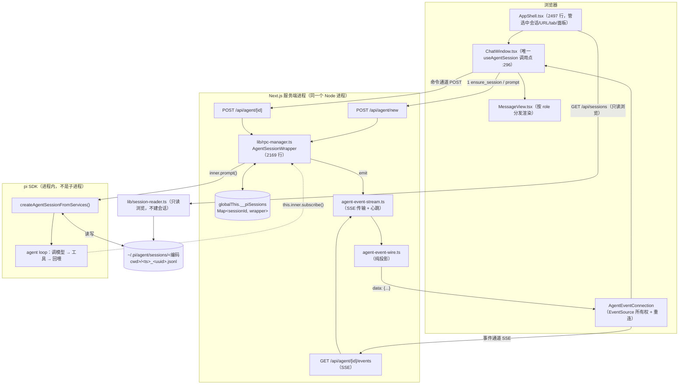
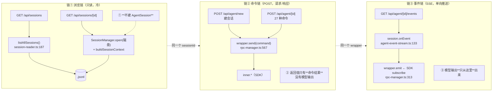
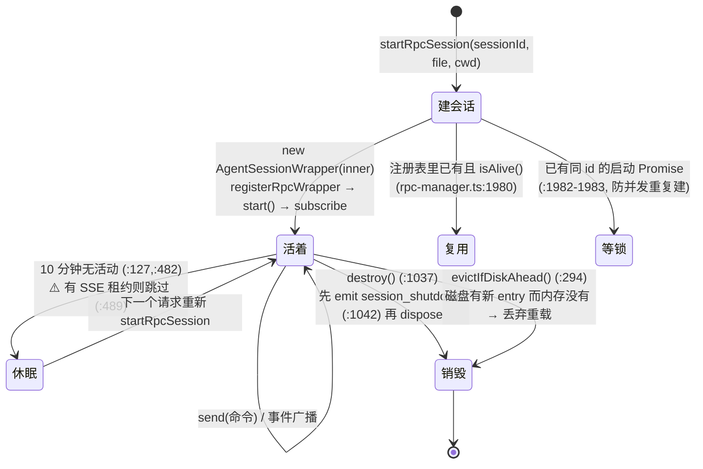

# pi-web —— pi 的浏览器外壳，站在产品层「外面」

> [返回索引](index.md) ｜ 基准项目：[pi.md](pi.md) ｜ 接缝清单：[pi-接缝清单.md](pi-接缝清单.md)
>
> **这份文档解决什么问题**：pi-web 是**别人第一次读会迷路**的项目——53 个路由、251 个 `lib/` 文件、两个 2000+ 行的 god file，
> 而且它**自己不带一条完整流程的说明**（`AGENTS.md` 给的是"零件清单 + 陷阱"，不是"一次对话从头到尾"）。
> 所以本文分两半：**上半 = 主流程串线**（回答"逻辑为什么串不起来"）；**下半 = 导航卡**（SOP：功能→位置映射 + 搜索配方）。
>
> **锚点（写死，别漂）**：`E:\agents-read\pi-web-main`，`@agegr/pi-web` **v0.9.1**，无 `.git`（纯源码快照）。
> ⚠️ **本文行号绑定这个快照**。换版本后先用符号名 grep 定位，别照抄行号。
> 另外：上一轮会话在快照根目录留了一份 `CODE-REVIEW.md`（质量评估 + 二开接手建议）——**那份讲"代码好不好、该先改哪"**，
> 本文讲"**一次对话怎么流过去**"，两份互补、不重复。
>
> **建议读法（30 分钟串通，别从头背）**：§0 三件事 → §1 一句话主链 → §4 三条链为什么混 → §5 生命周期 → §9 时间常数。
> 走完这五节，pi-web 的骨架就立住了；**§6~§8、§12~§15 当字典查**，不必一次读完。

---

# 上半：主流程串线

## 0. 先记住三件反直觉的事（否则后面全看不懂）

| # | 反直觉的事实 | 证据 | 为什么重要 |
|---|---|---|---|
| ① | **它不是 CLI 包装器，是 SDK 宿主。** 直接在 Next.js 服务端进程里 `import` 四个 pi 包（`pi-agent-core` / `pi-ai` / `pi-coding-agent` / `pi-tui`），用 `createAgentSessionFromServices()` 起会话 | `package.json:44-47`、`lib/rpc-manager.ts:2`、`:2108` | 所以 **agent 这一侧没有子进程、没有 RPC 协议**——文件名叫 `rpc-manager.ts` 是历史遗留。调试时断点直接落在同一个进程里（唯一的子进程在**终端面板**：node-pty 起真 shell，与 agent 无关） |
| ② | **一个会话有两条独立通道**：**命令走 POST**（请求—响应），**事件走 SSE**（单向推送）。两者不在一条连接上 | 命令 `lib/agent-client.ts:32`；事件 `lib/agent-event-stream.ts:51` | 这是"串不起来"的头号原因——你在读 POST 的返回值时，真正的输出其实从另一根管子流走了 |
| ③ | **同一份会话有两个真相源**：内存里活着的 `AgentSession`（在 `globalThis` 注册表）+ 磁盘上的 `.jsonl` 文件 | 注册表 `lib/rpc-manager.ts:1686`；文件 `lib/session-reader.ts:274` | 本文下半所有"看着多余的机制"（驱逐 / 租约 / 对账 / 快照重放）**全都是在给这两个源做对齐** |

> **一句话**：pi-web = **一个把「进程内的 pi 会话」翻译成「浏览器能看能点」的适配层**。它自己几乎不实现 agent 能力，
> 它实现的是**生命周期的接缝**。判断一个文件属于哪边，问一句：**"这是 pi 本来就有的，还是 pi-web 为了上网长出来的？"**

---

## 1. 一句话主链

```
浏览器输入 → POST /api/agent/new（建会话，type=ensure_session）
          → SSE /api/agent/[id]/events 连上（拿 connected 握手）
          → POST /api/agent/[id]（type=prompt）
              → startRpcSession()：进程内建 AgentSession（pi SDK）
              → wrapper.send("prompt") → inner.prompt()  ← 真正的 agent loop 从这里开始（在 pi 里）
          → wrapper 订阅 SDK 事件 → SSE 推给浏览器
          → useAgentSession.handleAgentEvent → dispatch → MessageView 渲染
          → agent_end（非终态）→ prompt_done / agent_settled（真终态）→ 30s 后关流
```

**关键点**：pi-web **只有前半段**。`inner.prompt()` 之后的"循环、调模型、跑工具"全在 pi SDK 里，
pi-web 只在**两头**做事——**进去之前**决定用什么模型/哪些工具/哪个会话，**出来之后**把事件翻译成人话。

> 这是**新会话**的路径。**已有会话**跳过第一步（`session.id` 已知），直接从「连 SSE」开始，命令发给 `POST /api/agent/[id]` 而不是 `/api/agent/new`——
> 两条路的区别只在服务端要不要**先建 wrapper**（`app/api/agent/[id]/route.ts:39` 热路径 vs `:55` 冷启动）。

---

## 2. 总览图



---

## 3. 七个阶段的代码落点

| 阶段 | 代码落点 | 一句话 |
|---|---|---|
| ① 页面装配 | `app/page.tsx:5` → `AppShell.tsx:78` → `ChatWindow.tsx:296` | 纯 props 层层下传，**没有全局 store**（全仓唯一 Context 是 i18n） |
| ② 建会话 | `useAgentSession.ts:1457`（`ensureNewSession` `:656`）→ `POST /api/agent/new` `:668` | 用 `type:"ensure_session"` 拿 pi 的真实 sessionId，**先建环境再发话** |
| ③ 连事件流 | `useAgentSession.ts:1467/1477`（**早于发命令**）→ `agent-event-connection.ts:74` | ⭐ 顺序是 **先连 SSE、后发 prompt**——这是"不丢开头"的唯一保证 |
| ④ 发 prompt | `useAgentSession.ts:1469/1479` → `app/api/agent/[id]/route.ts:39` → `rpc-manager.ts:567`（`send`）→ `:638`（`inner.prompt`） | 服务端在 **preflight 通过**后才 ACK（`:682`），不是"收到就回 200" |
| ⑤ agent loop | **在 pi SDK 里**（本仓库无代码） | pi-web 在这段期间只做一件事：把 `subscribe` 收到的事件 `emit` 出去（`:313`/`:327`） |
| ⑥ 事件回传 | `agent-event-stream.ts:133`（`onEvent`）→ `:104`（去重+投影）→ `:102`（`data:` 帧）→ `agent-event-connection.ts:140` | 中间过 `agent-event-wire.ts:58` 纯投影层：**丢 `turn_*`、剥 `partial`、裁字段** |
| ⑦ 客户端渲染 | `useAgentSession.ts:1149`（`handleAgentEvent`）→ `dispatch` → `streaming-message.ts:130`（reducer）→ `ChatWindow.tsx:1196` → `MessageView.tsx:275` | 流式走**尾部单独一个 MessageView**，不进 `messages` 数组（保 `memo`） |

---

## 4. ⭐ 为什么"串不起来"：三条链被混在了一张图里

上游 `AGENTS.md:25-39` 那张架构图**是对的但不够**——它把三条链画在了一起。**拆开看就通了**：



**三句话记住区别**：

1. **浏览链看的是"已经躺在磁盘上的东西"**——它和运行中的 agent 无关，`GET /api/sessions` 甚至不碰会话文件内容（只扫元信息，`session-list-scanner.ts:91`）。
2. **命令链是"我让你做一件事"**——`prompt` 的返回值是 `null`（`rpc-manager.ts:683`），**不是助手回复**。回复永远从链③来。
3. **事件链是"发生了什么"**——它连上时先补一个 `connected` 握手 + **当前正在流的那条消息的快照**（`agent-event-stream.ts:145-155`），这是"页面刷新不丢流"的实现方式。

> **判据**：看到一个新功能，先问"它读磁盘、还是发命令、还是听事件"——三选一之后，要去哪个文件就唯一了。

---

## 5. `AgentSessionWrapper` 生命周期（`lib/rpc-manager.ts:217`）

**这个类是 pi-web 的整个心脏**（2169 行，也是上游自己点名的"单点"，`CODE-REVIEW.md:141`）。它干四件事：
**订阅 SDK 事件并广播**、**当 RPC 命令分发器**、**管生命周期（建/复用/驱逐/销毁）**、**桥接扩展 UI 到浏览器**。

### 5.1 状态机



### 5.2 五个必须知道的机制

| 机制 | 位置 | 治什么病 |
|---|---|---|
| **注册表挂 `globalThis`** | `:1686-1701`（`__piSessions`） | Next.js dev 热重载会丢模块级 `Map`；挂 globalThis 才活得下来。同时注册 `exit`/`SIGINT`/`SIGTERM` 清理（`:1696-1698`） |
| **`__piStartLocks` 启动锁** | `:1982-1983`、`:2162-2167` | 并发请求同时建同一个会话 → 合并到一个 Promise。⚠️ `POST /api/agent/new` 因此必须用 `randomUUID()` 当临时 key，**不能用 `Date.now()`**（同毫秒会撞车合并两个新会话，`app/api/agent/new/route.ts:54-57` 有注释） |
| **10 分钟空闲自杀** | `:127`（可被 `PI_WEB_IDLE_TIMEOUT_MS` 覆盖，`0` 完全禁用）、`:482-499` | 不然每个打开过的会话都常驻内存。⚠️ 三种情况例外：**正在跑**（`isRunning()`，`:489`）与**有 SSE 租约**（同处）都会跳过；**用户点过停止**（`forceShutdownOnIdle` `:246`，由 `abort` `:690` / `abort_bash` `:1024` 置位）**优先于租约** |
| **SSE 租约豁免** | `:489` + `lib/session-liveness.ts:137`（TTL 90s） | ⭐ 治"我正开着这个会话，它却被空闲超时杀了"。浏览器每 30s `POST /api/agent/[id]/lease` 续租（`useAgentSession.ts:814`），TTL 到了没续就失效 |
| **磁盘领先驱逐** | `:294-302` | 治"另一个 pi 进程（TUI）往同一个文件写了新内容，我的内存副本过期了"→ 丢弃 wrapper、回落读盘。`isRunning()` 二次检查防误杀正在跑的会话 |

### 5.3 命令面（`send()` 的 27 个 case，`rpc-manager.ts:593-1036`）

| 命令 | 行 | 谁发（客户端） |
|---|---|---|
| `prompt`（含 `streamingBehavior: steer\|followUp`） | `:594` | `useAgentSession.ts:1469/1479/1882` |
| `abort` | `:689` | `:1565`（停止按钮） |
| `get_state` | `:700` | `GET /api/agent/[id]` `app/api/agent/[id]/route.ts:85` |
| `set_model` / `set_thinking_level` | `:729` / `:851` | `:1636` / `:1961` |
| `fork` / `fork_branch` / `clone` / `navigate_tree` | `:743` / `:793` / `:815` / `:843` | 见下一节 |
| `compact` / `abort_compaction` / `set_auto_compaction` | `:864` / `:979` / `:893` | `:1680` / `:1921` |
| `get_tools` / `set_tools` / `get_commands` | `:916` / `:954` / `:925` | `:1979` / 斜杠与 @ 补全 |
| `reload` | `:960` | `AgentsConfig.tsx:439`、`SettingsPanel.tsx:128`、`PluginsConfig.tsx:894` |
| `bash` / `abort_bash` | `:999` / `:1023` | `:1534`（`!` 前缀） |
| `set_session_name` / `get_session_stats` / `get_last_assistant_text` | `:874` / `:882` / `:889` | 内建斜杠命令 `:1766-1843` |
| `steer` / `follow_up` / `clear_queue` | `:904` / `:910` / `:898` | 队列操作 |
| `extension_ui_response` / `extension_ui_input` | `:984` / `:989` | 扩展弹窗应答 |

---

## 6. 分支：**四件套**，别再混成"两种分支"

上游 `AGENTS.md:154-157` 说"两种分支别混淆"，但代码里其实是**四条路**，判据是"**新文件还是同一个文件**"：

| 命令 | 语义 | 落盘行为 | UI 入口 | 行 |
|---|---|---|---|---|
| `fork` | **新会话**（从某条消息分出去） | 新建独立 `.jsonl`，`parentSession` 指向源文件 | 用户消息上的「新会话」 | `:743-791` |
| `fork_branch` | **在新会话里继续**（引用一段话） | 同上（`createBranchedSession(entryId)`），但**不关**当前 wrapper | 引用菜单「在新会话继续」`AppShell.tsx:945-957` | `:793-813` |
| `clone` | **克隆当前分支**成一个新会话 | 新建独立 `.jsonl`（在 `leafId` 处切），**关掉**源 wrapper | 斜杠命令 `/clone` `useAgentSession.ts:1838-1853` | `:815-841` |
| `navigate_tree` | **会话内切换分支**（换 leaf） | ⭐ **同一个文件**，只挪 `leafId` | `BranchNavigator` / 拖动分支 | `:843-849` |

**判据一句话**：**前三个产生新会话文件（侧边栏多一行"来源"标记），只有 `navigate_tree` 是在原地换分支**（前端随后 `loadSession(sid)` 重拉整棵 context，`useAgentSession.ts:1602`）。

> ⚠️ **`navigate_tree` 的准确说法是"不新建文件、不换 wrapper"，不是"不落盘"**：pi 的 `navigateTree` 在传 `summarize` / `label` 时**会追加条目落盘**（`branch_summary` / `label`，见 `node_modules/@earendil-works/pi-coding-agent/dist/core/agent-session.js:2595/2599/2612`）；
> pi-web 固定传 `{}`（`rpc-manager.ts:847`），所以走的是"只改内存叶指针"那条路（`session-manager.js:1049-1062`，注释原文 *"Existing entries are not modified or deleted"*）。**这也是为什么它敢不关 wrapper**。

⚠️ **上游点名的坑（`AGENTS.md:149-152`）**：`fork` 会**原地改 wrapper 内部状态**（`inner.sessionId` 变成新会话的 id），所以 `send("fork")` 必须在返回前 `this.destroy()`（`:152` 注释、`:788` `shutdownAfterSessionReplacement`）——
否则下一个请求拿到的是"已经 fork 过的"状态，再 fork 就会生成损坏的 `parentSession` 链。**改这段之前先把这条读完。**

---

## 7. 事件名总表（一张表回答"到底有哪些事件"）

三类来源，**混在同一条 SSE 里靠 JSON 的 `type` 区分**（没有 SSE `event:` 行，全是默认 message）。

### 7.1 pi SDK 原生事件（10 个 `AgentEvent` + 13 个 `AgentSessionEvent` 扩展）

| 事件 | 含义 | 客户端处理 |
|---|---|---|
| `agent_start` | 一轮 run 开始 | `useAgentSession.ts:1162` |
| `agent_end` | run 结束，**⚠️ 非终态**（retry / compaction / 扩展排队都会再来） | `:1170` |
| `agent_settled` | **agent 真正空闲**（SDK 等完所有 await listener） | `:1195` |
| `turn_start` / `turn_end` | 单轮边界 | ⚠️ **不出网**（wire 丢弃，`agent-event-wire.ts:26-29`、`:61`）；但**服务端内部仍消费 `turn_end`**——子 agent 运行时用它计 turn 数/软限流（`lib/subagent-runtime.ts:293`）。浏览器侧确实没有这两个 case |
| `message_start` / `message_update` / `message_end` | 消息生命周期 | `:1239` / `:1240` / `:1275` |
| `tool_execution_start` / `_update` / `_end` | 工具生命周期 | `:1306` / `:1316` / `:1351` |
| `queue_update` | steer/followUp 队列变化 | `:1367` |
| `compaction_start` / `compaction_end` | 压缩 | `:1380` / `:1386` |
| `auto_retry_start` / `auto_retry_end` | 自动重试 | `:1373` / `:1376` |
| `entry_appended` / `session_info_changed` / `thinking_level_changed` / `bash_execution_update` / `summarization_retry_*` | 落盘与元信息 | ⚠️ **客户端全部未处理**（静默忽略） |

### 7.2 pi-web 自造的事件（8 个，SDK 里没有）

| 事件 | 谁发 | 用途 |
|---|---|---|
| `connected` | `agent-event-stream.ts:147` | ⭐ **就绪握手**：客户端拿到它才算"流可用"（`agent-event-connection.ts:149`），否则等 60s 报 `ready_timeout` |
| `startup_error` | `:159` | 冷启动失败（建会话抛错），**终止性**——客户端不再重试 |
| `session_shutdown` | `rpc-manager.ts:1042` | wrapper 已销毁 → 服务端主动优雅关流（`:122-125`）。⚠️ 客户端 switch 里**没有这个 case**，只能靠 `onerror` 触发重连 |
| `prompt_done` / `prompt_error` | `:661` / `:670` | POST prompt 的**收尾**信号。⚠️ 这是"这一轮结束"的关键判据之一，不是 `agent_end` |
| `extension_error` | `:385` 等 | 扩展抛错 |
| `extension_ui_request` / `extension_ui_closed` | `:378` 等 / `:1492` | 扩展要弹窗（10 种子 method，类型见 `lib/types.ts:117-194`） |

### 7.3 疑似死分支（读代码时别被绕进去）

- `auto_compaction_start` / `auto_compaction_end`：客户端有 case（`:1379`/`:1385`）、`IDLE_RESET_EVENT_TYPES` 也含它（`rpc-manager.ts:123`），但**全仓找不到发出点**——旧 SDK 版本的遗留（上游 `AGENTS.md:179` 也这么说）。
- `lib/session-tree.ts:9` 的 `buildSessionTree`：**零生产调用**，侧边栏真正用的是 `lib/session-family.ts:46`，分支树用的是 `lib/project-tree.ts`。

---

## 8. 事件 → UI 动作映射（`useAgentSession.ts:1149` 的 switch）

| 事件 | 客户端动作 | 视觉效果 |
|---|---|---|
| `agent_start` | 起流式、`phase=waiting_model`、`dispatch(start)` | 出现"等待模型"占位 |
| `message_start`（assistant） | `dispatch(snapshot)`；⚠️ `role==="user"` 直接 `break`（用户消息已乐观插入） | 气泡出现 |
| `message_update` | `dispatch(delta)` 按 `assistantMessageEvent.type` 累加 | 逐 token 增长 |
| `message_end` | 落进 `messages`，⚠️ user 分支要跟"乐观气泡"对 key 去重（`:1281-1298`） | 气泡定稿、`messages` 接管 |
| `tool_execution_start` / `_update` | `phase=running_tools`；**只有 bash/powershell** 的部分输出进 `activeToolResults`（`:1321`） | 工具进度条 |
| `tool_execution_end` | 清掉该 toolCallId 的活动结果 | 工具段收尾 |
| `agent_end` | ⚠️ **不关流**、不复位 running，只 `loadSession` + 拉一次 state | 半截收尾 |
| `prompt_done` | `settleUiStage()`；SDK 若仍活跃则**留给 `agent_settled`**（`:1224`） | 结束态 |
| `agent_settled` | 真收尾 + `scheduleEventStreamClose()` | 声音/通知/刷新列表 |
| `compaction_start/end` | `isCompacting` 三态 | 压缩提示 |
| `extension_ui_request` | `handleExtensionUiRequest` | 扩展弹窗 |
| `queue_update` / `auto_retry_*` | 队列镜像 / 重试提示 | 顶部提示条 |

---

## 8.5 界面手势 → 命令对照（把 UI 接回命令面）

上一节的命令面有 27 个 case，**这张表回答"用户点了什么会走到哪个 case"**。
（**列内约定**：「客户端落点」列只写行号的都是 `hooks/useAgentSession.ts`；「服务端落点」列只写行号的都是 `lib/rpc-manager.ts`。）

| 界面手势 | 命令 | 客户端落点 | 服务端落点 |
|---|---|---|---|
| 输入框回车 | `prompt` | `useAgentSession.ts:1469/1479` | `rpc-manager.ts:594` |
| 运行中再发一句（steer / followUp） | `prompt` + `streamingBehavior` | `:1882` | `:594`（`:607` 读 behavior） |
| 点「停止」 | `abort` | `:1565` | `:689` |
| 输入 `!命令`（`!!` = 不入上下文） | `bash` | `:1534` | `:999` |
| 切换模型 | `set_model` | `:1636` | `:729` |
| 切换 thinking 档位 | `set_thinking_level` | `:1961` | `:851` |
| 改工具预设 | `set_tools` | `:1979` | `:954` |
| 点「压缩」/ 取消压缩 | `compact` / `abort_compaction` | `:1680` / `:1921` | `:864` / `:979` |
| 用户消息上的「新会话」 | `fork` | `:1577` | `:743` |
| 引用菜单「在新会话继续」 | `fork_branch` | `AppShell.tsx:950` | `:793` |
| `/clone` | `clone` | `:1843` | `:815` |
| 拖动/点击分支导航 | `navigate_tree` | `:1597`、`:1617` | `:843` |
| 内建斜杠命令（`/compact` `/reload` …） | 各自对应 | `:1766-1843` | 同左 |

**输入栏控件 → 后端**（`ChatInput.tsx` 是 2738 行的控件容器）：

| 控件 | 走向 | file:line |
|---|---|---|
| `@` 文件补全 | `GET /api/file-index?cwd=&q=` | `ChatInput.tsx:1028` |
| `/` 命令与技能补全 | `get_commands`（会话内）+ `GET /api/skills?cwd=` | `:1456` |
| 模型 / thinking / 工具 / 压缩 / 停止 | 见上表 | `ChatInput.tsx:2307-2645` |
| 附件（图片） | **无 API**，本地 base64（随 `prompt` 的 `images` 一起发） | `:2278-2305` |
| 草稿 | **无 API**，`lib/draft-store.ts` | `:686/867` |
| 声音开关 | **无 API**，localStorage `pi-sound-enabled` | `hooks/useAudio.ts:55` |

## 8.6 消息渲染：两个挂载点 + 一条旁路（最容易看错的地方）

| 事实 | 位置 | 为什么 |
|---|---|---|
| 流式与历史**共用 `MessageView`，但是两个实例** | 历史 `ChatWindow.tsx:1045`；流式尾部 `:1196` | 流式消息**不写进 `messages` 数组**（`:723-726` 注释：为了让 `MessageView` 的 `memo` 生效，避免整列表重渲染） |
| 流式内容由 `useReducer` 累积 | `lib/streaming-message.ts:130-152`（吃 `text_delta`/`thinking_delta`/`toolcall_delta`） | 高频增量不该走 React state 逐条同步 |
| `MessageView` 按 **`message.role`** 分发，**不看工具名** | `MessageView.tsx:275-293` | 工具长什么样由 `BlockView` 再按 `block.type` 分（`:905-925`） |
| ⚠️ **`toolResult` 直接 `return null`** | `MessageView.tsx:282-285`（`return null` 在 `:284`） | 工具结果**旁路**渲染：`ChatWindow.tsx:727-735` 把它合成 `toolResultsMap`（键 = `toolCallId`），再由 `BlockView` 用 `toolResults?.get(tc.toolCallId)` 配对到 toolCall 下面（`MessageView.tsx:914`）。**找不到"工具结果组件"是正常的**。⚠️ 那句注释写的是"skip if paired"，但代码是**无条件**返回 null——注释比代码乐观 |
| thinking 正文按需加载 | `deferThinking=1`（`useAgentSession.ts:505`）→ 点开才 `GET /api/sessions/[id]/entries/[entryId]/thinking` | 大会话不必一次传完 |

---

## 9. 时间常数总表（"为什么它要等 30 秒"全在这）

| 常数 | 值 | 位置 | 治什么病 |
|---|---|---|---|
| 会话空闲自杀 | 10 min | `rpc-manager.ts:127` | 内存 |
| 运行态轮询（侧边栏） | 2.5 s | `SessionSidebar.tsx:163`、`:562-599` | 只让**可见 tab** 轮询 `/api/agent/running`；后台 tab 停（用 `setTimeout` 自调度，不是 `setInterval`） |
| SSE 心跳 | 30 s | `agent-event-stream.ts:15` | 中间代理掐掉空闲连接 |
| SSE 租约 TTL | 90 s | `session-liveness.ts:3` | 浏览器崩了要能自动释放 |
| 租约续期 | 30 s | `useAgentSession.ts:185` | < TTL，留余量 |
| **SSE 空闲宽限** | 30 s | `:180` | ⭐ 一轮结束后不立刻关流——**扩展注入的 run 可能接着来**，先等再确认空闲 |
| 对账轮询 | 15 s | `:181` | ⭐ 移动端后台/网络掉线会**永久丢失 `agent_end`**，只能靠轮询兜底（`:1077-1081` 有注释） |
| bash 态对账 | 1 s | `:182` | `!` 命令的状态 |
| SSE 就绪超时 | 60 s | `:183` | 冷启动慢（要建会话+载扩展） |
| SSE 重连间隔 | 1 s | `:184` | **自管重连**，不用浏览器原生重连 |
| prompt settle 轮询 | 800 ms 起 / 600 ms 步 / 20 s 上限 | `:177-179` | 斜杠命令这类"没有流式事件"的收尾 |

> **一句话**：这些数字全是**两个真相源对齐**的代价。看懂了 §5.1 的状态机，这张表就是自然结果——**没有一个数字是为了"体验好看"加的**。

---

## 10. 断线/刷新/并发：三条兜底链路（pi-web 最"工程"的一段）

| 场景 | 兜底手段 | 位置 |
|---|---|---|
| 页面刷新时正在流 | SSE 连上时**先发快照**（当前 `streamingMessage` + 缓冲事件），再做实时转发 | `agent-event-stream.ts:119-155` |
| 快照与事件重复 | `isEventIncludedInSnapshot()`：同一条消息对象只发一次 | `agent-event-wire.ts:100-107` |
| 错过 `agent_end`（后台 tab） | 15 s 轮询 + `visibilitychange` + `online` → `reconcileAgentState()`，发现服务端已空闲就本地收尾 | `useAgentSession.ts:1082-1143` |
| 迟到事件"复活幽灵气泡" | `message_*` 开头的 `if (!agentRunningRef.current) break` + **单调 run id**（`promptRunIdRef`）作废跨 run 的慢响应 | `:1244`/`:1279`、`:375`/`:1427`/`:1092` |
| 进程退出但 SSE 还挂着 | `instrumentation-node.ts:10` → `closeAllAgentEventStreams()` **硬断**（`controller.error`）；否则 Next 16 生产环境 `server.close()` 没有超时，进程变僵尸 | `agent-event-stream.ts:17-41`、`:83-84` |
| 两个请求同时建同一个会话 | `__piStartLocks` 合并 | `rpc-manager.ts:1982` |

---

# 下半：导航卡（SOP）

## 11. 定位与组织哲学

- **定位**：学它**"怎么给一个已有 agent 内核套一层 Web 产品外壳"**——即**适配层/接缝设计**，而不是学 agent 本身。
  它站在 [pi-接缝清单.md](pi-接缝清单.md) 的**第 ③ 层（产品层 `pi-coding-agent`）外面**：只用 `createAgentSession*` / `SessionManager` / 扩展 API，**不碰** `runAgentLoop`（① 层）也不碰 `AgentHarness`（② 层）。
- **组织哲学**：**不是 monorepo，就一个 Next.js 应用**。但内部分工极清晰：
  - `app/api/**/route.ts` = **薄路由**（53 个路由，平均 42 行，`CODE-REVIEW.md:24`）——只做参数校验 + 调 `lib/`
  - `lib/` = **服务端逻辑**（251 个文件，含 session/rpc/安全/模型/文件/git）
  - `components/` + `hooks/` = **客户端**（`useAgentSession` 一个 hook 吃掉全部聊天状态）
  - `bin/` = npm CLI 入口（`bin/pi-web.js` 起 `next start`）
  - **一个功能 = 一个文件 + 同目录一个 `.test.mjs`**（181 个测试文件与实现同目录，命名 `xxx.test.mjs`）

## 12. 目录结构（只列核心）

```
pi-web-main/
├─ bin/            pi-web.js（CLI：解析参数 → 起 next start → Ready 后开浏览器）
├─ app/
│  ├─ page.tsx     Home → I18nProvider → AppShell
│  ├─ api/
│  │  ├─ agent/    ⭐ 三条通道的入口：new / [id]（POST 命令+GET state）/ [id]/events（SSE）
│  │  │              + [id]/lease（租约续期）、[id]/bash-output、running
│  │  ├─ sessions/ 只读浏览：列表 / 详情 / context?leafId / state / export / auto-name / search
│  │  ├─ models*、auth/*、plugins、skills、subagents、tools/settings   ← 配置面
│  │  ├─ files/、git/、file-index、cwd/*、worktrees、default-cwd      ← 文件与项目面
│  │  ├─ terminal/*（node-pty + SSE）、web-auth、project-trust、push/*
├─ lib/            ⭐ 服务端核心（见下）
├─ components/     AppShell / ChatWindow / ChatInput / MessageView / SessionSidebar / FileViewer…
├─ hooks/          useAgentSession（2277 行，聊天唯一状态机）+ 若干 UI hook
├─ e2e/            Playwright 浏览器回归（自己的 dev server + 临时 PI_CODING_AGENT_DIR）
└─ docs/adr/       3 篇真正的 ADR（0001 环境隔离 / 0002 chat-only 工具选择 / 0003 子 agent 开关）
```

**`lib/` 里必须认识的 12 个文件**：

| 文件 | 行数 | 一句话 |
|---|---|---|
| `rpc-manager.ts` | 2169 | ⭐ **心脏**：`AgentSessionWrapper` + 注册表 + `startRpcSession` |
| `session-reader.ts` | 727 | 只读浏览：磁盘 → `SessionContext`（含 `entryIds[]`） |
| `agent-event-stream.ts` | 187 | SSE 传输：心跳 / 快照重放 / 关闭 / 租约 |
| `agent-event-wire.ts` | 107 | 纯投影：丢 `turn_*`、剥 `partial`、裁 `agent_end` |
| `agent-event-connection.ts` | 202 | 浏览器侧 EventSource 所有权 + 握手 + 1s 重连 |
| `agent-client.ts` | 53 | 命令通道的唯一客户端封装（`sendAgentCommand`） |
| `session-liveness.ts` | 199 | 租约：SSE 在 → 会话不被空闲杀 |
| `session-tool-selection.ts` | 52 | 工具选择持久化（`pi-web:tool-selection` custom entry） |
| `tool-presets.ts` | 48 | `none/read-only/default/full` 四档工具集 |
| `path-security.ts` | 42 | ⭐ **安全边界**（`isPathWithinRoots`，Windows/POSIX 双规则） |
| `file-access.ts` | 58 | 允许根 allow-list（`/api/files` 的唯一守门人） |
| `subagent-extension.ts` | 313 | 内置子 agent（`Agent`/`get_subagent_result`/`steer_subagent`） |

## 13. 功能 → 位置映射（ETCLOVG 七层）

> 七层是穷尽坐标系（见 `workspace/理论核心-ETCLOVG落地.md`）。**没有的层明说没有。**

| 层 | pi-web 的实现 | 位置 | 已读 |
|---|---|---|---|
| **E** 执行环境与沙箱 | bash/powershell 工具由 **pi SDK** 提供；pi-web 只做**环境隔离**（剥掉 `PORT`/`NODE_ENV`/`NEXT_*`）+ 项目信任门禁。**无 OS 级沙箱**（不像 codex） | `lib/project-command-env.ts:90`（`InlineExtension`）、`docs/adr/0001`、`lib/project-trust.ts`、`lib/powershell-settings.ts` | ✅ 本会话 |
| | 真实终端（`node-pty` + xterm + SSE，**绕过 agent**，直连用户） | `app/api/terminal/[id]/{route,events}.ts`、`lib/terminal-manager.ts:13` | ✅ |
| **T** 工具接口与协议 | ⚠️ **7 个内置编码工具本体全在 pi**（`read/bash/edit/write/grep/find/ls`，定义在 npm 包里）。pi-web 只做**选择与开关**：四档预设 + 会话级 `set_tools` + 持久化 custom entry | `lib/tool-presets.ts:12-15`、`lib/session-tool-selection.ts:5`、`app/api/tools/settings` | ✅ |
| | pi-web 自己**只注册 2 个内联扩展**（环境隔离 bash + 内置 subagent）；且**只自己定义了 3 个工具**——都在 subagent 扩展里（`Agent` / `get_subagent_result` / `steer_subagent`）。⚠️ 限定：① "2 个"仅指**非 chatOnly** 分支（chatOnly 时整块 `extensionFactories` 被换成 `CHAT_ONLY_RESOURCE_LOADER_OPTIONS`，`:2052-2062`）② `project-command-env.ts` 是**复用** pi 的 `createBashToolDefinition` 再包 `execute`，不算自定义 | `rpc-manager.ts:2063-2075`、`lib/subagent-extension.ts:133/228/263`、`lib/project-command-env.ts:2/95-107` | ✅ |
| **C** 上下文与记忆 | 会话文件（`.jsonl`）+ 父子会话；**压缩由 pi 做**，pi-web 只做 UI 三态与摘要解析 | `lib/session-reader.ts`、`lib/compaction-summary.ts` | ✅ |
| | 会话树/族：subagent 归族 + worktree 过滤 + 分支树（三件事三个文件，**别混**） | `lib/session-family.ts:46`、`lib/worktree.ts:97`、`lib/project-tree.ts` | ✅ |
| | 每工作区"上次打开的会话"记忆（localStorage） | `lib/workspace-memory.ts` | ✅ |
| **L** 生命周期与编排 | ⭐ **本项目的重心**：`AgentSessionWrapper` 建/复用/驱逐/销毁 + 空闲策略 + 启动锁 | `lib/rpc-manager.ts:217`、`:1966` | ✅ 精读 |
| | 子 agent：独立 controller + profile 文件（`~/.pi/agent/agents/*.md`）+ 队列 | `lib/subagent-runtime.ts`、`lib/subagents.ts:12-14` | ✅ |
| | 扩展体系桥接：扩展 UI 请求 → 浏览器弹窗（`extension_ui_request` / `Response`） | `rpc-manager.ts:1114-1685` | ✅ 部分 |
| **O** 可观测性 | 事件流本身即观测面（§7 表）；另有会话统计、provider 用量、应用更新检查 | `useAgentSession.ts:1149`、`app/api/provider-usage/query`、`app/api/app-update` | ✅ |
| | ⚠️ **无内置 trace/rollout**（不像 codex rollout / 我们自己的 `.traces/`）——pi 的 jsonl 就是唯一记录 | — | ✅ |
| **V** 验证与评估 | 181 个测试文件与实现**同目录**（`lib/` 121 / `components/` 41）；Playwright E2E 自己起 dev server | `package.json:40`、`e2e/README.md` | ✅ |
| | ⚠️ **测试文件为什么全叫 `*.test.mjs`**（全仓 191 个 `.mjs`，其中 181 个是测试，**源码里没有 `.mjs`**）：`package.json` **没有 `"type": "module"`**（因为 `bin/*.js` 是 CJS，用 `require`）⇒ `.js` 会被当 CJS，而测试要 ESM + 顶层 await ⇒ 只能显式 `.mjs`；runner 是 Node 自带 `node --test`（**不是 vitest/jest**），所以没有"框架帮转译 TS"这层 | `package.json:40`（glob 写死 `**/*.test.mjs`）、`bin/pi-web.js:5` | ✅ |
| | ⚠️ **`.mjs` 怎么跑 `.ts` 源码？四种写法并存**（实测互斥计数）：**jiti** 99 个（`createJiti(..., { tsconfigPaths: true })`，因为源码内部用 `@/` 别名，Node 原生不认）／**懒加载 `import("./x.ts")`** 29 个 + **静态 `import from "./x.ts"`** 16 个（这两档靠 `--experimental-strip-types`，都只用于依赖图里没有 `@/` 的纯逻辑模块）／**完全不载入实现、只读源码文本做正则断言** 37 个（`components/` 占 22） | `lib/rpc-manager.test.mjs:9-10`（jiti）、`lib/ansi.test.mjs:4-6`（懒加载）、`app/api/agent/events-route.test.mjs:5-6`（正则） | ✅ |
| | ⚠️ 前端测试的真实覆盖：37 个正则档里 `components/` 占 22；另有 14 个测试用 jiti 载 `.tsx`，其中只有 10 个用 `renderToStaticMarkup` 做 **SSR 单帧**渲染——**全仓没有 jsdom / @testing-library / createRoot** ⇒ 交互、effect、事件一律测不到。重命名函数会让正则变红，逻辑坏了照样绿 | `components/*.test.mjs`（`renderToStaticMarkup` 10 处） | ✅ |
| | ⚠️ 但**前端测试多是"读源码打正则"**（35.6% 断言如此）——重命名就红、逻辑坏了照样绿。详见 `CODE-REVIEW.md:110-130` | — | ✅ |
| | CI：lint + tsc + 单测 + E2E 两个 job | `.github/workflows/ci.yml` | ✅ |
| **G** 治理与安全 | 请求门禁（Origin/Host 校验 + 可选密码 + Basic Auth + 节流） | `proxy.ts:13`、`lib/request-security.ts`、`lib/web-auth.ts`、`lib/auth-throttle.ts` | ✅ |
| | 文件访问边界（allow-list，单一实现） | `lib/path-security.ts:9`、`lib/file-access.ts`、`lib/allowed-roots.ts` | ✅ |
| | 项目信任（不自动执行仓库里的 `.pi/extensions`） | `lib/project-trust.ts`、`docs/adr/0003` | ✅ |
| | ⚠️ **两处已知例外**（`CODE-REVIEW.md:145-148`）：`/api/cwd/browse` 不走 allow-list；`/api/files` 对"会话文本里出现过的路径"放行 | `app/api/cwd/browse/route.ts:26-40`、`lib/session-file-references-core.ts:67-74` | ✅ |
| **附加** UI / 模型适配 | UI：无全局 store，纯 props + 回调上抛；`useAgentSession` 只在 `ChatWindow.tsx:296` 调用一次 | `AppShell.tsx:78`、`ChatWindow.tsx:296` | ✅ |
| | 模型适配：**全在 `pi-ai`**；pi-web 只做面板、作用域解析（`enabledModels` glob）、凭据与用量 | `lib/model-scope.ts`、`lib/provider-listing.ts`、`components/ModelsConfig.tsx` | ✅ |

## 14. 搜索配方

- **语言 / 技术栈**：TypeScript + Next.js 16（App Router，Turbopack）+ React 19；测试用 `node --test`（`--experimental-strip-types`）+ Playwright；无 Tailwind 类名体系（`globals.css` 的 CSS 变量 + 大量 inline style）
- **找"发命令"**：grep `sendAgentCommand` → 命中处就是命令发出点；命令名清单看 `rpc-manager.ts` 的 `switch (type)`
- **找"发事件"**：grep `this.emit(` / `emit({ type:` → 都在 `rpc-manager.ts`
- **找"收事件"**：grep `case "` 在 `useAgentSession.ts` 的 `handleAgentEvent`
- **找"某个 API 谁在调"**：在该 API 路径片段前加引号 grep（如 `grep '"/api/worktrees'`），或用下面第 3 条配方一次列出全部客户端调用
- **找"磁盘格式"**：grep `SessionEntry` / `entryToUiMessage` 在 `lib/types.ts` + `lib/session-reader.ts`
- **找"安全边界"**：只用两个词 —— `isPathWithinRoots`、`allowFileRoot`
- **grep 示例**（真实可用）：
  ```
  # 所有会推给浏览器的 pi-web 私有事件
  rg 'type: "(connected|startup_error|prompt_done|prompt_error|session_shutdown|extension_)' lib/
  # 所有 AgentSession 生命周期入口
  rg 'startRpcSession|getRpcSession|destroy\(\)|evictIfDiskAhead' lib/ app/
  # 客户端调用了哪些接口
  rg -o '"/api/[a-z0-9/\[\]._-]+' components/ hooks/
  ```
- **注意**：
  - `node_modules/` **巨大**（pi SDK 全套），搜索务必排除；要读 SDK 定义去 `node_modules/@earendil-works/pi-*/dist/*.d.ts`
  - `tsconfig.tsbuildinfo` 是构建产物，grep 会命中一大坨 JSON——一并排除
  - 组件测试多为"读源码 + 正则"，**改代码前先看同目录 `.test.mjs` 里有没有 `assert.match(source, ...)` 锁住结构**

## 15. 二开对接：你们站在 pi 的哪个接缝上

按 [pi-接缝清单.md](pi-接缝清单.md) 第 0 步判据（看 `package.json` 依赖 + `grep "@earendil-works/pi"`）：

| 判据 | pi-web 的答案 | 你们的项目应该看 |
|---|---|---|
| 依赖了哪些包 | `pi-agent-core` / `pi-ai` / `pi-coding-agent` / `pi-tui` 四个全有 | 你们依赖哪几个 → 决定站在 ③ 还是 ②/① |
| 调了哪个装配入口 | ⭐ **只用 `createAgentSessionServices()` + `createAgentSessionFromServices()`**，**从未**出现 `runAgentLoop` / `AgentHarness.create` / `new Agent()`（全仓 grep 实测）。四处调用点：`rpc-manager.ts:2041/2108`（主会话）、`subagent-runtime.ts:196/259`（子 agent 各建一套）、`model-runtime.ts:20` + `app/api/models/route.ts:40`（**只为拿模型列表也建一套 services**） | grep 这三个入口，看你们用哪个 |
| 怎么拿事件 | `inner.subscribe(listener)`（`:313`）——**SDK 事件面**，不是 `AgentLoopConfig` 回调 | 你们是订阅事件还是注入回调 |
| 怎么加工具 | `registerTool(defineTool(...))` 走 `InlineExtension`（`subagent-extension.ts:133`），**或**不传 `tools` 让扩展工具全注册、再用 `setActiveToolsByName` 收窄（`:2020-2026` 有踩坑注释） | `customTools` / `defineTool` / `beforeToolCall` 的命中情况 |
| 怎么改提示词 | `agent.state.systemPrompt` + 包一层 `prepareNextTurnWithContext`（`:434-452`） | `systemPrompt` / `buildSystemPrompt` |
| 最该先读的业务文件 | ⭐ `lib/rpc-manager.ts`（**接线板**：27 个命令 + 全部生命周期都在这一个文件） | 你们项目里 grep `createAgentSession` 命中最密的那个文件 |

**一条给二开的实用判据**：pi-web 里凡"看起来该 pi 管、却由 pi-web 写了一大段"的地方，**就是它的增量所在**——
`rpc-manager.ts` 的 `send()` switch（27 个命令）、`agent-event-wire.ts` 的字段裁剪、`session-reader.ts` 自己重写的 `buildSessionContext`（**故意不复用 SDK 的压缩折叠**，`:506-507`）。
这三处是"抄谁、为什么抄、不抄会怎样"的最佳素材。

## 16. ⚠️ 已知坑与未核实项

**上游自己点名的坑（`AGENTS.md` 的 Key Design Decisions）**——按对我的帮助排序：

1. **fork 必须立刻销毁 wrapper**（`AGENTS.md:149-152`）——否则 `parentSession` 链损坏。
2. **`POST /api/agent/new` 的临时 key 必须 `randomUUID()`**（`app/api/agent/new/route.ts:54-57` 有注释）——`Date.now()` 同毫秒会合并两个新会话。
3. **两种（实为四种）分支别混**（`AGENTS.md:154-157`，见本文 §6）。
4. **toolCall 字段错配**：磁盘 `{id,name,arguments}` vs 前端 `{toolCallId,toolName,input}` → 必须过 `normalizeToolCalls`（`lib/normalize.ts:26-39`），**磁盘加载与流式两条路都要过**。
5. **UNC 路径不能拆段再拼**（`AGENTS.md:199`）——`\\host\share` 会被拼成相对路径，allow-check 全 403。
6. **Windows 路径必须用 `samePath()` 比较**（`AGENTS.md:193`）——`===` 曾让 worktree 切换器整个消失。
7. **dev 期间不要 `next build`**（`AGENTS.md:11`）——会污染 `.next/` 打断 dev server。

**本会话新发现 / 未核实（诚实标注）**：

| # | 事项 | 状态 |
|---|---|---|
| 1 | `auto_compaction_start/end` 只有消费者没有生产者 | 疑似旧 SDK 遗留，**未查 git 历史**（快照无 `.git`） |
| 2 | `session_shutdown` 客户端无 case，靠 `onerror` 重连"自愈" | **推断，未实测** |
| 3 | `message_update` 的 wire 实际载荷比 SDK 声明的类型少字段（靠 `as` 断言绕过） | **确认现象，是否有意未证实** |
| 4 | pi-web 的 `buildSessionContext` 不做压缩折叠 ⇒ `messages` 里仍含被压缩掉的旧消息 | 注释说是故意的（SDK 会"整页丢消息"），**复现条件未验证** |
| 5 | `readSessionRelationEntries` 只读文件前 2 行 ⇒ subagent meta 不紧邻 header 就读不到 | 未验证 SDK 是否保证顺序 |
| 6 | `getPresetFromToolNames` 把扩展工具全过滤 ⇒ 含扩展工具的会话一律判成 `default` | 像是刻意简化，**未确认** |
| 7 | {`UseAgentSessionOptions.sessionRunning`} 从未被读取，但 `ChatWindow` 还在传 | 疑似死参数 |
| 8 | `lib/session-title.ts:171` 判断 `role === "compactionSummary"`，而联合类型里没有这个 role | 疑似死分支 |

---

## 17. 读图要点（三句话记住 pi-web）

1. **它是个"外壳"，不是"大脑"**：`inner.prompt()` 之后的一切都在 pi 里；pi-web 的活儿是**进去之前选参数、出来之后翻译事件**。
2. **两条管子 + 两个真相源**：命令走 POST、事件走 SSE；内存有 wrapper、磁盘有 jsonl。**所有"多余"的机制都是给这两组东西做对齐**——看懂了 §5.1 和 §9，pi-web 就再没有神秘的地方。
3. **要改什么，先去 §13 定位层，再去 §14 搜索**：`rpc-manager.ts` 是接线板，`useAgentSession.ts` 是前端接线板，`agent-event-wire.ts` 是两者的边界。
